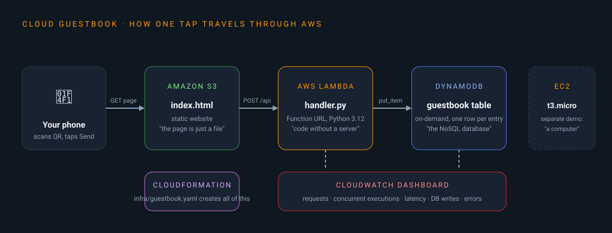
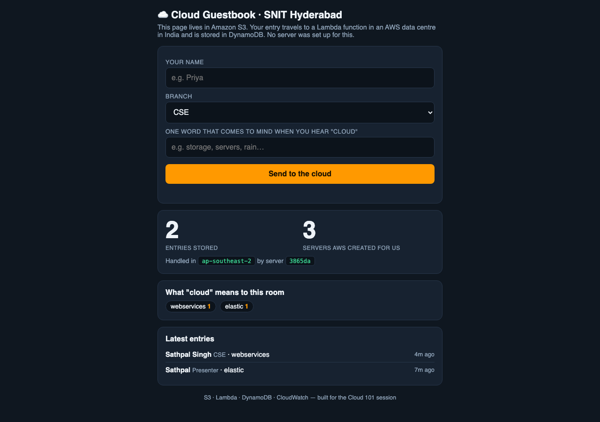
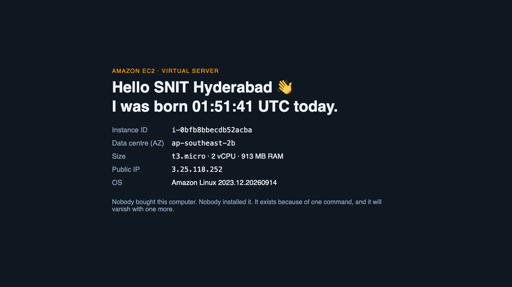
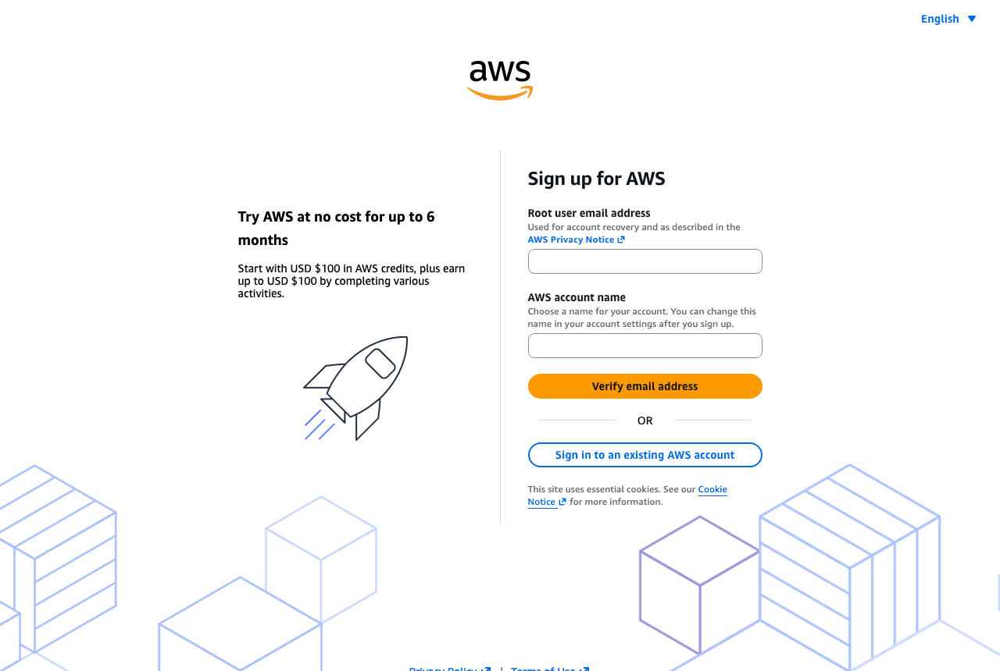
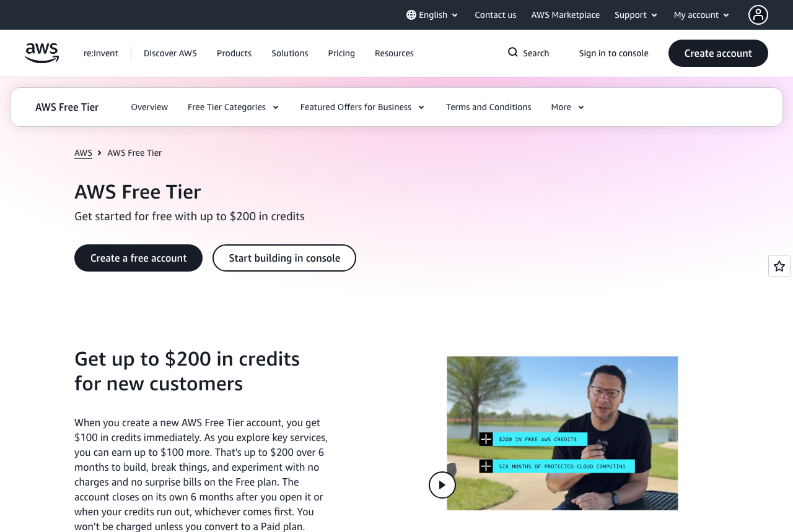
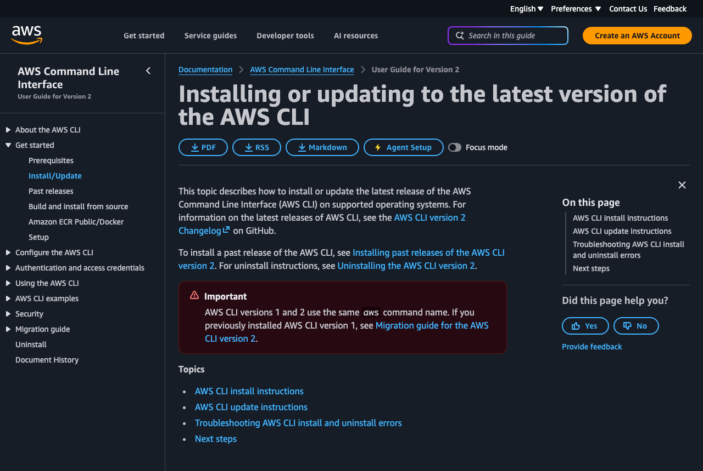
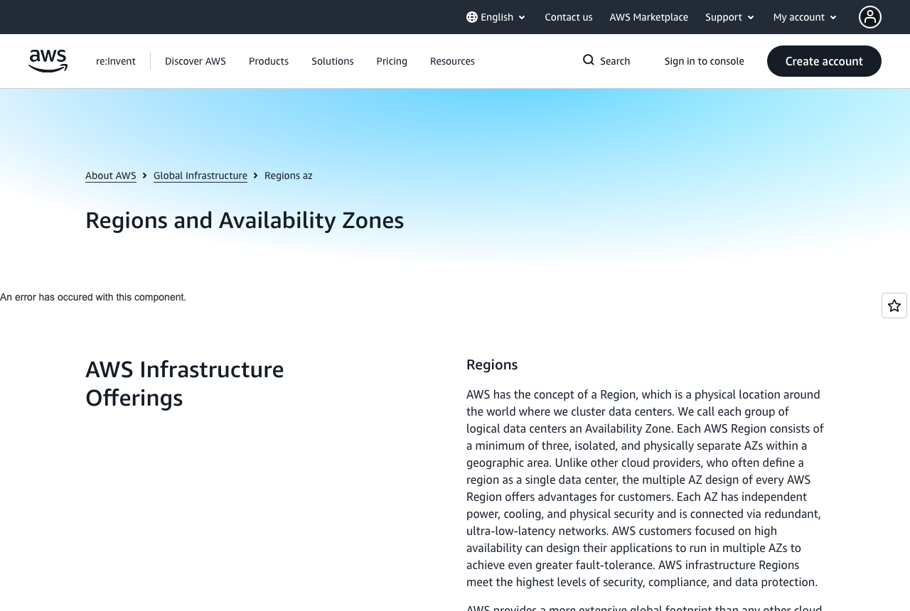
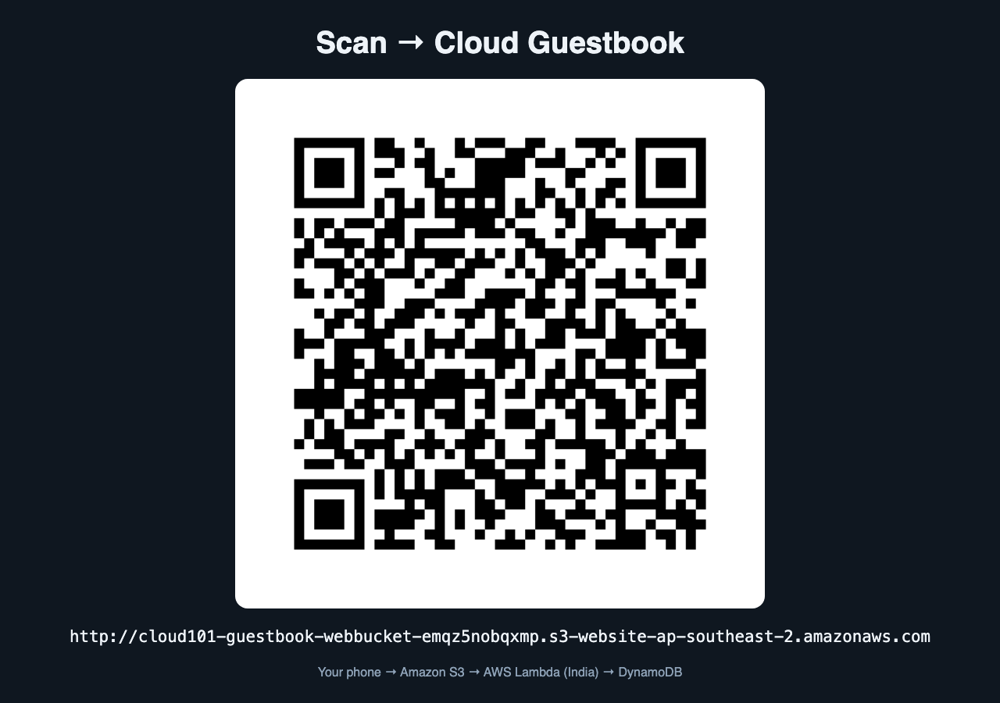
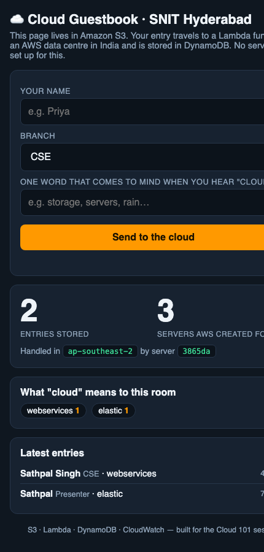

# Cloud 101 · Build your first thing on AWS

A step-by-step guide for students. You start with **no AWS account** and finish with a small, real,
serverless web app running in an AWS data centre, load-tested by you, and deleted by you.
Total time: about 90 minutes the first time. Cost: **₹0** if you follow the cleanup step.

You will build the **Cloud Guestbook** you saw in the session: a web page on S3, an API on Lambda,
a database on DynamoDB, a live dashboard on CloudWatch, all created from one file by CloudFormation.
You will also rent a Linux server on EC2 for a few minutes and then throw it away.



| What you'll see | Screenshot |
|---|---|
| The guestbook page, served from S3, talking to Lambda and DynamoDB |  |
| Your own EC2 server reporting its instance ID, data centre and IP |  |

---

## Contents

1. [Create an AWS account](#1-create-an-aws-account)
2. [Protect the root user](#2-protect-the-root-user)
3. [Create an IAM user and an access key](#3-create-an-iam-user-and-an-access-key)
4. [Install the tools](#4-install-the-tools)
5. [Connect the CLI to your account](#5-connect-the-cli-to-your-account)
6. [Get the code](#6-get-the-code)
7. [Preflight check](#7-preflight-check)
8. [Demo 1 · Rent a computer (EC2)](#8-demo-1--rent-a-computer-ec2)
9. [Demo 2 · Create the guestbook from one file (CloudFormation)](#9-demo-2--create-the-guestbook-from-one-file-cloudformation)
10. [Demo 3 · Use it from your phone](#10-demo-3--use-it-from-your-phone)
11. [Demo 4 · Follow one request through the console](#11-demo-4--follow-one-request-through-the-console)
12. [Demo 5 · Hit it with 200 requests](#12-demo-5--hit-it-with-200-requests)
13. [Demo 6 (optional) · Ask an AI model](#13-demo-6-optional--ask-an-ai-model)
14. [Delete everything](#14-delete-everything)
15. [Troubleshooting](#15-troubleshooting)
16. [What next](#16-what-next)
17. [Repo layout](#17-repo-layout)

---

## 1. Create an AWS account

You need: an email address you control, a mobile number, and a debit or credit card.
The card is used for identity verification. AWS may place a small temporary hold (about ₹2) that is reversed.



1. Open **https://aws.amazon.com/free** and click **Create a free account**.
2. **Root user email address**: use a personal email you will keep for years. **AWS account name**: anything, for example `priya-cloud101`.
3. Click **Verify email address**, open the mail from AWS and type the 6-digit code.
4. Set a **root user password**. Make it long and store it in a password manager. This password controls the whole account.
5. **Contact information**: choose **Personal**, fill your name, phone and address.
6. **Billing information**: enter your card. Nothing is charged on the Free plan.
7. **Identity verification**: choose SMS or voice call, type the code AWS sends.
8. **Choose a plan**: pick the **Free plan**.
9. Click **Go to the AWS Management Console** and sign in with the root email and password.

### About the Free plan (as of 2025, check the page for changes)



- You get **USD 100 in credits** immediately and can earn up to USD 100 more by completing short activities in the console.
- The Free plan **cannot be charged**. It closes on its own after 6 months or when the credits run out, whichever is first.
- Everything in this guide uses a tiny fraction of those credits. The only thing that costs while idle is the EC2 server, and step 14 deletes it.

---

## 2. Protect the root user

Do this once, right after signing in. Takes 3 minutes.

1. Click your account name at the top right, then **Security credentials**.
2. Under **Multi-factor authentication (MFA)** click **Assign MFA device**.
3. Choose **Authenticator app**, scan the QR with Google Authenticator or Authy, type two consecutive codes, done.
4. Never create an access key for the root user. Never share the root password.

From now on you will use the root user only for billing and account settings. Daily work happens with an IAM user.

---

## 3. Create an IAM user and an access key

The command line cannot use your browser login. It needs an **access key**, which belongs to an IAM user.

1. In the console search box type **IAM** and open it.
2. Left menu: **Users**, then **Create user**.
3. **User name**: `cloud101`. Leave "Provide user access to the AWS Management Console" unticked. **Next**.
4. **Permissions options**: choose **Attach policies directly**, tick **AdministratorAccess**, **Next**, **Create user**.
   Administrator access is fine for a learning account that you will delete. At a job you would get far less.
5. Click the user `cloud101`, open the **Security credentials** tab, scroll to **Access keys**, click **Create access key**.
6. Use case: **Command Line Interface (CLI)**. Tick the confirmation box. **Next**, **Create access key**.
7. You now see an **Access key ID** and a **Secret access key**. Click **Download .csv file** and keep it somewhere safe.
   The secret is shown **only once**.

> **Security rule you will hear again in every job:** never paste an access key into code, a chat, a screenshot, or a Git repository.
> If a key leaks, bots find it within minutes and start mining crypto on your bill. If that happens, go to IAM and click **Deactivate** on the key.

---

## 4. Install the tools

You need five command line tools: `aws`, `jq`, `curl`, `zip` and `uv` (which provides `uvx` for the QR code generator).



### macOS

```bash
/bin/bash -c "$(curl -fsSL https://raw.githubusercontent.com/Homebrew/install/HEAD/install.sh)"   # skip if you have Homebrew
brew install awscli jq uv
```

### Windows

Use **WSL 2** with Ubuntu. The scripts are Bash scripts and will not run in PowerShell.

1. Open PowerShell as Administrator and run `wsl --install`, then reboot.
2. Open the **Ubuntu** app from the Start menu and follow the **Linux** steps below inside it.
3. Keep the repo inside the Linux filesystem, for example `~/aws-cloud-101-demo`, not under `/mnt/c`.

### Linux (Ubuntu / Debian, and WSL)

```bash
sudo apt update && sudo apt install -y jq curl zip unzip git
curl "https://awscli.amazonaws.com/awscli-exe-linux-x86_64.zip" -o /tmp/awscliv2.zip   # on ARM use awscli-exe-linux-aarch64.zip
unzip -q /tmp/awscliv2.zip -d /tmp && sudo /tmp/aws/install
curl -LsSf https://astral.sh/uv/install.sh | sh
source ~/.bashrc
```

### Check

```bash
aws --version && jq --version && curl --version | head -1 && zip -v | head -2 && uvx --version
```

All five should print a version.

---

## 5. Connect the CLI to your account

```bash
aws configure
```

Answer the four prompts with the values from the CSV you downloaded in step 3:

```
AWS Access Key ID [None]:     AKIA................
AWS Secret Access Key [None]: ........................................
Default region name [None]:   ap-south-1
Default output format [None]: json
```

`ap-south-1` is **Mumbai**. Every AWS region has a code like this. Hyderabad is `ap-south-2`, Sydney is `ap-southeast-2`.



Confirm it works. This prints your account ID and the `cloud101` user:

```bash
aws sts get-caller-identity
```

---

## 6. Get the code

```bash
git clone https://github.com/sathpal/aws-cloud-101-demo.git
cd aws-cloud-101-demo
```

Have a look around before running anything. The three files that matter:

| File | What it is |
|---|---|
| [infra/guestbook.yaml](infra/guestbook.yaml) | The whole guestbook described as one CloudFormation file: a table, a bucket, a role, a function, a public URL, a dashboard |
| [lambda/handler.py](lambda/handler.py) | About 80 lines of Python. This is the entire backend. It runs only when someone hits Send |
| [scripts/ec2-userdata.sh](scripts/ec2-userdata.sh) | What the EC2 server runs on first boot: install a web server, write a page about itself |

---

## 7. Preflight check

```bash
scripts/preflight.sh
```

It checks the tools, your credentials, the region, whether your account allows public S3 websites, and whether a default VPC exists for EC2.
Everything should be green. If something is red, go to [Troubleshooting](#15-troubleshooting).

---

## 8. Demo 1 · Rent a computer (EC2)

```bash
scripts/ec2-demo.sh
```

What happens, in order (read the script, it is 25 lines):

1. Asks AWS for the ID of the latest **Amazon Linux 2023** image. An image (AMI) is a ready-made operating system.
2. Finds your **default VPC**, your private network inside AWS.
3. Creates a **security group** called `cloud101-web`. This is a firewall. It opens only port 80 (web) to the internet.
4. Calls `run-instances` for one **t3.micro** (2 vCPU, 1 GB RAM) and passes `ec2-userdata.sh` as the first-boot script.
5. Waits until the instance is running, then polls its public IP until the web page answers, and opens it in your browser.

About 90 seconds later you get a page like this, built by the server itself from its own metadata:


**Look in the console:** search **EC2**, click **Instances**. Watch the state go `pending` then `running`.
Click the instance, then the **Security** tab: that is the firewall you created. Note the **Availability Zone**: that is a physical data centre.

Optional: `scripts/ec2-demo.sh 3` launches three more, spread across data centres, while you watch.

---

## 9. Demo 2 · Create the guestbook from one file (CloudFormation)

Open [infra/guestbook.yaml](infra/guestbook.yaml) in your editor and scroll through it. Every block under `Resources:` becomes a real thing in AWS. Then:

```bash
scripts/deploy.sh
```

What happens:

1. `aws cloudformation deploy` sends the YAML to AWS. AWS creates the resources in dependency order: table, bucket, bucket policy, IAM role, function, function URL, two permissions, dashboard.
2. The script zips `handler.py` together with a copy of the page and uploads it to the Lambda function.
3. It writes the function's URL into `web/index.html` and copies the page to the S3 bucket.
4. It checks the S3 website answers with HTTP 200 and prints your URLs.

Expected output ends like this:

```
✔ Done in 79 s
  Students open : http://cloud101-guestbook-webbucket-xxxx.s3-website-ap-south-1.amazonaws.com
  API           : https://xxxx.lambda-url.ap-south-1.on.aws/api
  Dashboard     : https://ap-south-1.console.aws.amazon.com/cloudwatch/home?region=ap-south-1#dashboards:name=cloud101-guestbook-live
```

**Look in the console:** search **CloudFormation**, click the stack `cloud101-guestbook`.
The **Events** tab shows each resource being created with a timestamp. The **Resources** tab lists them with links.
On-premises this would be a purchase order, a rack, and weeks of waiting.

---

## 10. Demo 3 · Use it from your phone

```bash
scripts/qr.sh
```

A full-screen QR page opens. Scan it with your phone, type your name, branch and one word, tap **Send to the cloud**.



Your entry appears on the page within a couple of seconds, along with two counters:

- **Entries stored**: rows in DynamoDB.
- **Servers AWS created for us**: how many separate copies of your Lambda code have run so far. Right now it is 1. Remember that number.



---

## 11. Demo 4 · Follow one request through the console

Trace your own entry. Open these in the console, in this order.

1. **S3**: open the bucket whose name starts with `cloud101-guestbook-webbucket`. The only object is `index.html`.
   The page you scanned is just this file. Under **Properties**, scroll to **Static website hosting** to see the URL.
2. **Lambda**: open the function whose name starts with `cloud101-guestbook-Fn`. The **Code** tab shows `handler.py`.
   The **Monitor** tab shows one invocation per request. Before you tapped Send, this code was not running anywhere.
3. **DynamoDB**: open **Tables**, click the table, then **Explore table items**. Click **Scan** then **Run**. Find your row.
   It has an `id`, a timestamp `ts`, your three fields, and `instance`: the six-character tag of the Lambda copy that wrote it.
4. **CloudWatch**: open **Dashboards**, click `cloud101-guestbook-live`. Five graphs: requests, concurrent executions, response time, database writes, errors.

Terminal shortcut for the same numbers:

```bash
scripts/status.sh
```

---

## 12. Demo 5 · Hit it with 200 requests

"What happens if the whole college opens it at once on results day?"

Open the CloudWatch dashboard first, set the time range to **1h** and auto-refresh to **10 s**. Then:

```bash
scripts/blast.sh 200
```

This fires 200 POST requests, 50 at a time. Expected output:

```
Sending 200 requests, 50 at a time, to https://xxxx.lambda-url.ap-south-1.on.aws/api
 200 201
  elapsed: 5.0 s
✔ Handled by 41 distinct Lambda instances so far. Now open the dashboard: ...
```

Every request returned `201 Created`. Lambda noticed 50 requests arriving together and started more copies of your code to absorb them.
Reload the guestbook page: the "servers AWS created for us" counter jumped from 1 to about 40. Nobody added a server.
Within a minute the dashboard shows the spike, and **Errors** stays at zero.

Now delete the 200 fake rows and keep the real ones:

```bash
scripts/reset.sh
```

---

## 13. Demo 6 (optional) · Ask an AI model

Amazon Bedrock offers AI models as an API in the same account, with the same CLI.

1. In the console search **Bedrock**, open **Model access**, and request access to a Claude or Amazon Nova text model in your region.
   New accounts sometimes need a verification period of a few hours before this works.
2. Then:

```bash
scripts/ai-demo.sh "Explain cloud computing to a first-year student in 3 lines, with one cricket analogy."
```

If it says no model is visible, skip this step. It is a bonus.

---

## 14. Delete everything

This is the most important step. Do it the same day.

```bash
scripts/ec2-cleanup.sh     # terminates the server(s) and deletes the security group
scripts/destroy.sh         # empties the bucket and deletes the whole CloudFormation stack
```

Both wait until AWS confirms the deletion. Then check the console: **EC2 → Instances** shows `terminated`, and **CloudFormation** shows no stack.
Finally, if you are done for a while, go to **IAM → Users → cloud101 → Security credentials** and **Deactivate** the access key.

Try returning a physical server to a vendor after 25 minutes.

---

## 15. Troubleshooting

| Symptom | Cause | Fix |
|---|---|---|
| `preflight.sh` says no working credentials | `aws configure` not done, or wrong key | Re-run `aws configure`. Check the CSV. Run `aws sts get-caller-identity` |
| `explicit deny in a service control policy` | You are in a company or training sandbox account, not your own | Ask the account owner which region is allowed, then `aws configure set region <that-region>`. Or use your own account |
| Region warning "not ap-south-1" | You picked a different region | Harmless. The demo works in any region. Change with `aws configure set region ap-south-1` |
| `No default VPC` | Some accounts have it deleted | `aws ec2 create-default-vpc` |
| EC2 launch fails with capacity or type error | t3.micro unavailable in that zone | `TYPE=t2.micro scripts/ec2-demo.sh` |
| S3 website URL returns 403 | Account-level **Block Public Access** is on | Console → S3 → **Block Public Access settings for this account** → Edit → untick → Save. Or just use the Lambda URL, which `deploy.sh` prints as a fallback |
| Function URL returns `403 Forbidden` in curl | Public Function URLs need two permissions (`InvokeFunctionUrl` and `InvokeFunction`) | Already in the template. If you edited it, restore both `AWS::Lambda::Permission` resources |
| Page says "Cannot reach the API right now" but curl works | The API sent two `Access-Control-Allow-Origin` headers. Browsers reject that | Already fixed in `handler.py`: CORS headers must come only from the Function URL config, not from the code |
| `deploy.sh` fails with `UPDATE_ROLLBACK_COMPLETE` | A template change was invalid; AWS rolled back | `aws cloudformation describe-stack-events --stack-name cloud101-guestbook` shows the reason. Fix and re-run |
| `uvx: command not found` | uv not installed or shell not reloaded | `source ~/.bashrc` (or open a new terminal), see step 4 |
| Bedrock says account is being verified | New account | Wait a few hours or skip step 13 |

---

## 16. What next

- **Week 1**: rebuild this from scratch without the scripts. Click through the console to create the same bucket, function and table by hand. Then read the YAML again.
- **Week 2**: the AWS Cloud Practitioner course on **AWS Skill Builder** is free. The exam is CLF-C02.
- **Week 3**: fork this repo and add a feature. Ideas: photo upload to S3, a leaderboard by branch, a delete-my-entry button, a second region.
- **Week 4**: put a resume site on S3 plus one Lambda API on your GitHub. A repo beats a certificate in an interview.

Free things worth knowing: AWS Educate, AWS Skill Builder, AWS Academy through your college, the AWS User Group in Hyderabad, and AWS Community Day.

---

## 17. Repo layout

```
README.md            this guide (students)
PRESENTER.md         setup notes for whoever presents the session
RUNBOOK.md           the 2-hour session plan, talking points, fallbacks
CONSOLE-TABS.md      console links to show an audience
infra/guestbook.yaml CloudFormation template: everything in the guestbook
lambda/handler.py    the backend
web/index.html       the page
scripts/             one script per demo step (read them, they are short)
slides/deck.html     the session slides
docs/                diagram and screenshots
```

| Script | Purpose |
|---|---|
| `scripts/preflight.sh` | Tools, credentials, region, S3 public-access setting, default VPC, Bedrock |
| `scripts/ec2-demo.sh [count]` | Launch web server(s), wait until they answer, open in browser |
| `scripts/ec2-cleanup.sh` | Terminate them and delete the security group |
| `scripts/deploy.sh` | Create or update the guestbook stack, upload code and page. `STACK=name` picks a stack name |
| `scripts/qr.sh [url]` | Full-screen QR page |
| `scripts/status.sh` | Entry count, requests, concurrency, latency, errors in the last 10 min |
| `scripts/blast.sh [n] [parallel]` | Load test (default 200 requests, 50 parallel) |
| `scripts/reset.sh [--all]` | Delete load-test rows, or all rows |
| `scripts/destroy.sh` | Empty the bucket and delete the stack |
| `scripts/ai-demo.sh [question]` | Ask a Bedrock model (optional) |

All scripts honour the `AWS_REGION` and `STACK` environment variables.
